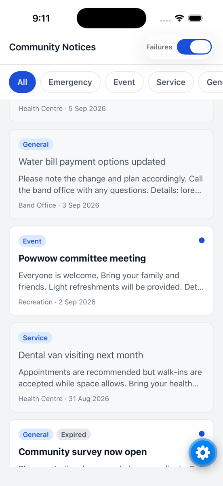
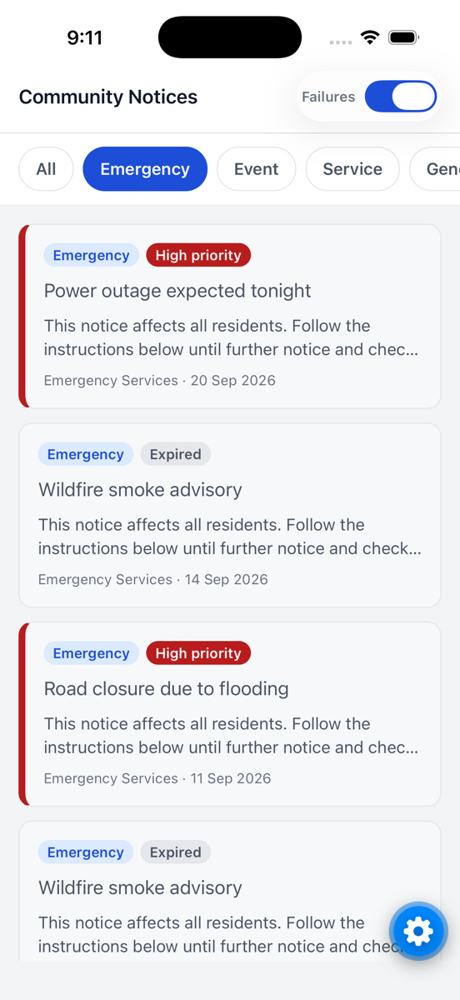
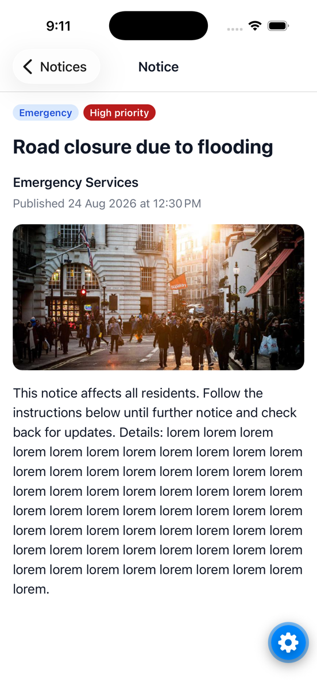

# Community Notices

Expo SDK 58 + React Navigation 7 + TypeScript. A paged, filterable notice list and a detail screen, backed by an in-app mock API over `src/data/notices.json`.

<p>
  
  
  
</p>

## 1. How to run

```bash
npm install
npx expo start      # press i (iOS simulator) or a (Android emulator)
```

Runs in Expo Go; no dev build needed. `npm run typecheck` and `npm run lint` pass. Maestro flows in `.maestro/` need a dev build (`npx expo run:ios`) and then `npm run test:e2e`. The mock API fails about 1 in 5 requests by default (`src/services/api-services/mock-api-config.ts`, or the **Failures** switch in the header in dev). Use airplane mode to test offline.

## 2. Decisions and trade-offs

- **Layers:** api-services → storage → hooks → screens (Container/View/Styles). Screens never call the API or storage directly. Setting `EXPO_PUBLIC_API_BASE_URL` swaps the mock for an Axios client.
- **State:** I used hooks and a pure `feedReducer` instead of a data library. Refresh and load-more keep separate errors, so a failure never clears the list. Request sequence numbers drop late responses after a filter change.
- **Offline:** the last list for each filter is cached in AsyncStorage and shown instantly, with a "last updated" banner and Retry. The app refetches when the connection returns.
- **Read state:** a persisted Set in context. The provider waits for storage before rendering, so read notices don't flash as unread on launch.

| Edge case | Handling |
| --- | --- |
| Very long title | 2 lines in the list, shown in full on the detail screen |
| Empty body | No preview line in the list; the detail screen says to contact the department |
| Expired | Still shown, with an "Expired" badge and no high-priority styling (hiding them felt worse) |
| Broken image | A placeholder replaces it; the rest of the notice still renders |
| Future publish date | The mock server hides it until its clock (`mockApiConfig.now`) reaches the publish date |
| Malformed record | Dropped by the mapper; an unknown category falls back to `general` |

## 3. Before shipping

- **Testing:** unit tests for `feedReducer` and the mappers, hook tests for `useNoticeFeed` with a fake API (failure on page 2, offline, reconnect), and Maestro checks in CI.
- **Crash reporting and monitoring:** Sentry with source maps from EAS Build. Track API error rate and time to first content.
- **Releases:** EAS Build profiles (dev/preview/prod), EAS Submit, and EAS Update channels for OTA fixes. CI runs typecheck, lint and tests on every PR.
- An accessibility pass with VoiceOver and TalkBack.

## 4. With more time

- TanStack Query (`useInfiniteQuery` + persister) instead of the hand-rolled cache.
- Full offline mode: today only the last loaded list for each filter is cached. I'd store every fetched notice in `expo-sqlite`, so all pages, filters and detail screens work offline. Images would be prefetched to disk, and the app would sync only what changed when it reconnects.
- Cursor pagination, so new notices can't shift pages.
- Server-synced read state and push notifications for urgent notices.
- List thumbnails and dark mode.
